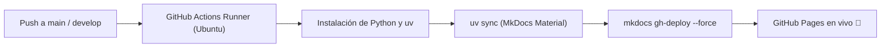

# 🧬 Simulador del Dogma Central de la Biología Molecular

[](https://duodinamic0.github.io/BIO-simulacion-dogma-central)
[](https://www.python.org/)
[](https://docs.astral.sh/uv/)
[](https://squidfunk.github.io/mkdocs-material/)

Este proyecto es un simulador interactivo y pedagógico desarrollado para la asignatura de **Bioinformática**, diseñado para modelar con rigor y claridad el flujo completo de la información genética celular:

$$\text{ADN} \xrightarrow{\text{Replicación}} \text{ADN} \xrightarrow{\text{Transcripción}} \text{ARNm} \xrightarrow{\text{Traducción}} \text{Proteína}$$

---

## 🌐 Web de Apoyo Visual y Documentación

Para complementar la experiencia en consola y ofrecer soporte visual durante la defensa del proyecto, disponemos de una plataforma web interactiva y detallada:

👉 **[https://duodinamic0.github.io/BIO-simulacion-dogma-central](https://duodinamic0.github.io/BIO-simulacion-dogma-central)**

- **Despliegue Continuo (CI/CD)**: La web se construye y despliega automáticamente en **GitHub Pages** mediante **GitHub Actions** (`.github/workflows/deploy.yml`) en cada cambio en las ramas principales (`main`, `master`, `develop`).
- **Contenido Teórico y Gráfico**: Incluye esquemas moleculares, diagramas Mermaid, animaciones conceptuales, tablas enzimáticas y la fundamentación teórica de cada fase del dogma.
- **Construida con MkDocs Material**: Con soporte para modo claro/oscuro, renderizado matemático con MathJax y navegación estructurada por pestañas.

---

## 📁 Arquitectura del Proyecto

El repositorio está estructurado de manera modular y desacoplada:

```text
BIO-simulacion-dogma-central/
│
├── replicacion.py              # Lógica de replicación (helicasa, primasa, líder, rezagada, Okazaki y ligasa)
├── transcripcion.py            # Lógica de transcripción (ADN molde/codificante a ARNm 5'->3', complementariedad U-A)
├── traduccion.py               # Código genético, ribosoma (sitios A, P, E), ARNt y síntesis del polipéptido
├── main.py                     # Interfaz de consola interactiva en tiempo real, menús, validaciones y exportador HTML
│
├── docs/                       # Fuente de la web de apoyo visual (MkDocs)
│   ├── index.md                # Portada y visión general del dogma
│   ├── replicacion.md          # Fundamento y pasos de la replicación
│   ├── transcripcion.md        # Detalle de la transcripción y polaridades
│   ├── traduccion.md           # Mecanismo ribosomal y código genético
│   └── assets/                 # Imágenes, diagramas y recursos multimedia
│
├── .github/
│   └── workflows/
│       └── deploy.yml          # Flujo de GitHub Actions para el despliegue automático en GitHub Pages
│
├── mkdocs.yml                  # Configuración del sitio web de documentación con Material for MkDocs
├── pyproject.toml              # Definición del proyecto y dependencias de la documentación
├── uv.lock                     # Bloqueo de dependencias para entornos reproducibles con uv
├── simulador_dogma.html        # Reporte gráfico interactivo generado automáticamente tras la simulación
└── README.md                   # Documentación principal del repositorio
```

---

## 🧬 Fundamento Biológico y Procesos Simulados

### 1. Replicación Semiconservativa (`replicacion.py`)
- **Apertura de la Horquilla y Estabilización**:
  - **Helicasa**: Rompe los puentes de hidrógeno entre las bases nitrogenadas para desespiralizar la doble hélice.
  - **Topoisomerasa / Girasa**: Disipa la tensión torsional por delante de la horquilla evitando el superenrollamiento.
  - **Proteínas SSB (*Single-Stranded Binding*)**: Estabilizan las hebras sencillas evitando que se reasocien prematuramente.
- **Cadena Líder / Adelantada (*Continuous Strand*)**:
  - Sobre el molde $3' \to 5'$, la **ARN Primasa** sintetiza un único cebador de inicio. La **ADN Polimerasa III** elonga continuamente en sentido $5' \to 3'$ avanzando hacia la horquilla.
- **Cadena Rezagada / Retrasada (*Lagging Strand*) y Fragmentos de Okazaki**:
  - Al discurrir el molde en orientación $5' \to 3'$, la síntesis es discontinua y se aleja de la horquilla.
  - La **ARN Primasa** inserta cebadores periódicos.
  - La **ADN Polimerasa III** sintetiza los **Fragmentos de Okazaki** en dirección $5' \to 3'$.
  - La **ADN Polimerasa I** elimina los cebadores de ARN mediante su actividad exonucleasa $5' \to 3'$ y rellena los huecos con desoxirribonucleótidos de ADN.
  - La **ADN Ligasa** sella las muescas (*nicks*) catalizando los enlaces fosfodiéster.
- **Resultado Semiconservativo**: Se generan 2 moléculas bicatenarias idénticas, conteniendo cada una una hebra parental original y una hebra de nueva síntesis.

---

### 2. Transcripción (`transcripcion.py`)
- **Diferenciación de Cadenas y Polaridad**:
  - **Cadena Molde (antisentido, $3' \to 5'$)**: Hebra leída físicamente por la polimerasa.
  - **Cadena Codificante (sentido, $5' \to 3'$)**: Hebra complementaria a la molde cuya secuencia coincide con el transcrito resultante (reemplazando T por U).
- **ARN Polimerasa y Burbuja de Transcripción**:
  - Abre localmente el ADN y sintetiza el ARNm en dirección $5' \to 3'$ incorporando ribonucleótidos trifosfato (rNTPs).
  - Regla estricta de complementariedad con el molde:
    - $\text{Adenina (molde)} \to \text{Uracilo (ARNm)}$
    - $\text{Timina (molde)} \to \text{Adenina (ARNm)}$
    - $\text{Citosina (molde)} \to \text{Guanina (ARNm)}$
    - $\text{Guanina (molde)} \to \text{Citosina (ARNm)}$
- **Maduración y Terminación**:
  - Al encontrar la señal de terminación, se libera el transcrito primario de ARNm maduro listo para la traducción.

---

### 3. Traducción (`traduccion.py`)
- **Código Genético Universal**:
  - Diccionario completo de 64 codones $\to$ 20 aminoácidos estándar + 3 codones de parada (*Stop*).
- **Iniciación y Escaneo 5'-UTR**:
  - La subunidad menor del ribosoma escanea el ARNm hasta detectar el codón de inicio **AUG**.
  - El primer complejo iniciador con el ARNt ($3'-\text{UAC}-5'$) cargado con **Metionina (Met)** se acopla en el **Sitio P**.
- **Ciclo Ribosomal en los Sitios A, P y E**:
  - **Sitio A (Aminoacilo)**: Entrada y reconocimiento por complementariedad de bases del aminoacil-ARNt según el codón expuesto.
  - **Sitio P (Peptidilo)**: Formación del enlace peptídico catalizado por la **peptidil transferasa**, transfiriendo la cadena al nuevo aminoácido.
  - **Sitio E (*Exit* / Salida)**: Expulsión del ARNt desacoplado sin aminoácido.
  - **Translocación**: Desplazamiento del ribosoma 3 nucleótidos en dirección $5' \to 3'$.
- **Terminación y Factores de Liberación**:
  - Al ingresar un codón de parada (**UAA**, **UAG** o **UGA**), un **Factor de Liberación (RF)** induce la hidrólisis del polipéptido maduro ($\text{N-terminal} \to \text{C-terminal}$) y la disociación de las subunidades ribosomales.

---

## ⚡ Características Principales del Simulador

1. **Entrada de Datos Flexible**:
   - **Manual**: Permite teclear cualquier secuencia de nucleótidos o usar la secuencia de demostración calibrada.
   - **Archivos FASTA**: Compatible con archivos `.fasta`, `.fa` y `.txt`, procesando la cabecera del registro y validando los nucleótidos.
   - **Selector de Polaridad**: Posibilidad de indicar si la secuencia introducida corresponde a la cadena codificante ($5' \to 3'$) o a la cadena molde ($3' \to 5'$).
2. **Control de Ritmo y Presentación**:
   - **Modo Paso a Paso Interactivo**: Permite pulsar `[ENTER]` entre cada evento enzimático, ideal para explicaciones detalladas en la defensa académica.
   - **Modo Automático Cinemático**: Progresa automáticamente con animaciones y pausas en tiempo real.
3. **Ejecución Modular**:
   - Simulación integrada completa (Dogma completo: 1 $\to$ 2 $\to$ 3).
   - Ejecución independiente por fases (Solo Replicación, Solo Transcripción o Solo Traducción).
4. **Validaciones Biológicas Inteligentes**:
   - **Codón AUG ausente**: Si el transcrito no posee `AUG`, el programa alerta al usuario y ofrece prependerlo o editar el ARNm directamente en la terminal sin reiniciar la replicación ni la transcripción previa.
   - **Codón de Parada (Frenada)**: Verifica la presencia de codón Stop al final del marco de lectura para garantizar la terminación correcta del polipéptido.
5. **Exportador a Reporte HTML (`simulador_dogma.html`)**:
   - Al finalizar, genera un reporte visual independiente con diseño moderno, tarjetas explicativas de cada enzima, secuencias formateadas y desglose tabular de cada ciclo ribosomal.

---

## 🚀 Instalación y Puesta en Marcha

### Requisitos
- **Python**: 3.10 o superior (compatible con Python 3.14).
- El núcleo del simulador CLI no requiere librerías externas (utiliza únicamente la librería estándar de Python).

### Opción 1: Con `uv` (Recomendado)

Si dispones de [`uv`](https://docs.astral.sh/uv/):

```bash
# 1. Clonar el repositorio
git clone https://github.com/duodinamic0/BIO-simulacion-dogma-central.git
cd BIO-simulacion-dogma-central

# 2. Sincronizar el entorno
uv sync

# 3. Ejecutar el simulador por consola
uv run python main.py

# 4. (Opcional) Levantar la web de apoyo visual en local
uv run mkdocs serve
```

### Opción 2: Con Python Estándar

```bash
# 1. Clonar el repositorio
git clone https://github.com/duodinamic0/BIO-simulacion-dogma-central.git
cd BIO-simulacion-dogma-central

# 2. Ejecutar el simulador directamente
python main.py
```

Si deseas levantar el servidor local de la web de documentación con Python estándar:

```bash
pip install -r pyproject.toml
mkdocs serve
```

---

## 🔄 Flujo de Trabajo CI/CD

El repositorio cuenta con una integración continua configurada en `.github/workflows/deploy.yml`:



Cada actualización en las ramas principales compila la documentación Markdown y la publica inmediatamente en la URL pública de GitHub Pages.
