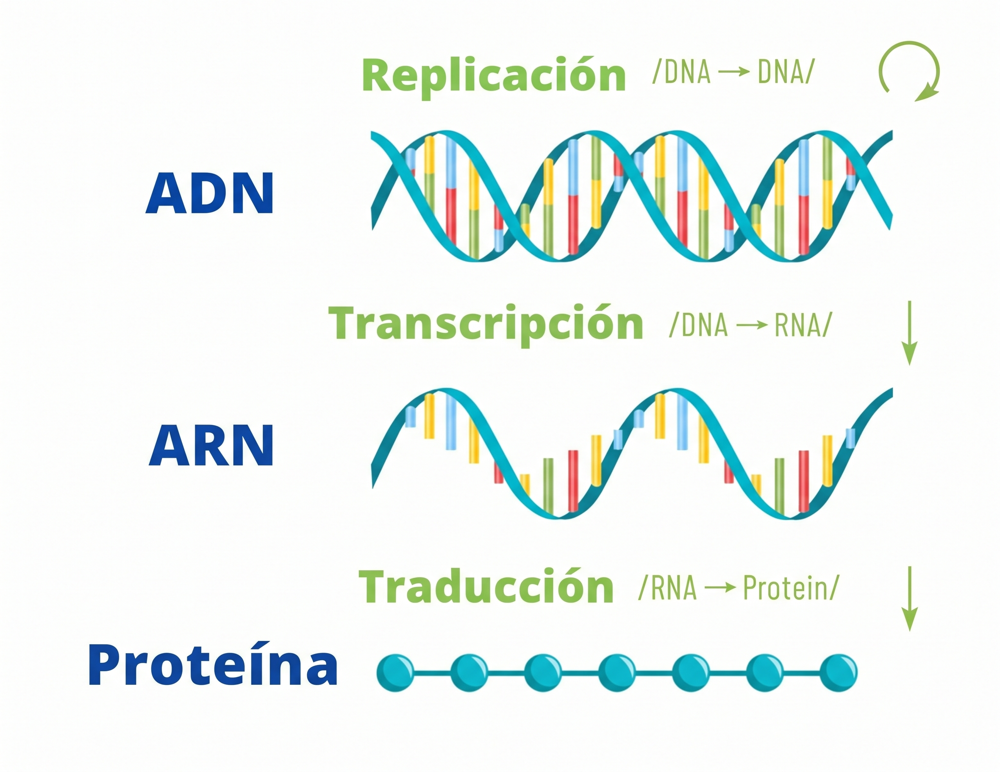
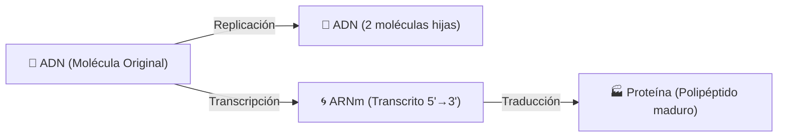

# Simulador del Dogma Central de la Biología Molecular

<div align="center">
  <p><strong>Práctica 1 · Bioinformática</strong></p>
  <p><em>Simulación integrada del flujo de información genética celular en Python</em></p>
</div>



## Introducción y Objetivos

El **Dogma Central de la Biología Molecular** describe el flujo unidireccional de la información genética en los sistemas biológicos. Este proyecto implementa un simulador por consola interactivo, didáctico y modular para representar en tiempo real cada una de las fases moleculares:



### Objetivos Clave de la Práctica
- **Replicación Semiconservativa**: Simular la apertura de la horquilla por la **Helicasa**, la síntesis continua en la **cadena líder** y la síntesis discontinua con **fragmentos de Okazaki** en la **cadena rezagada**, mediada por **ARN Primasa**, **ADN Polimerasa I y III** y **ADN Ligasa**.
- **Transcripción de Alta Fidelidad**: Diferenciar la **cadena molde ($3' \to 5'$)** de la **cadena codificante ($5' \to 3'$)**, simulando la **burbuja de transcripción** y la sustitución de Timina por Uracilo en el ARNm.
- **Traducción Ribosomal**: Búsqueda del marco abierto de lectura a partir del codón **AUG (Metionina)**, simulación de los **sitios A, P y E** del ribosoma y elongación de aminoácidos hasta encontrar codones de parada (**Stop**).

## Arquitectura Modular del Código

| Archivo                 | Proceso Biológico              | Enzimas y Elementos Clave                                                      |
|:------------------------|:-------------------------------|:-------------------------------------------------------------------------------|
| [`replicacion.py`](#)   | Replicación Semiconservativa   | Helicasa, Topoisomerasa, SSB, Primasa, ADN Pol III, ADN Pol I, Ligasa          |
| [`transcripcion.py`](#) | Transcripción ADN $\to$ ARNm   | ARN Polimerasa, Promotor, Burbuja de transcripción, regla $A \to U$            |
| [`traduccion.py`](#)    | Traducción ARNm $\to$ Proteína | Ribosoma (sitios A, P, E), ARNt con anticodón, Peptidil transferasa, Factor RF |
| [`main.py`](#)          | Integrador y CLI               | UI en tiempo real, modo paso a paso interactivo            |


## Inicio Rápido

Para poner en marcha el simulador interactivo en local:

=== "Con uv (Recomendado)"
    ```bash
    # Ejecutar directamente el simulador
    uv run python main.py
    ```

=== "Con Python estándar"
    ```bash
    # Ejecutar con el intérprete de Python
    python main.py
    ```

=== "Levantar esta web de documentación"
    ```bash
    # Servidor local con recarga en vivo
    uv run mkdocs serve
    ```

[//]: # (---)

[//]: # (## Navegación del Proyecto)

[//]: # ()
[//]: # (A través de las secciones de esta documentación podrás explorar al detalle los fundamentos biológicos de cada etapa y el código que los modela:)

[//]: # ()
[//]: # (- [x] **Inicio &#40;Portada&#41;**: Presentación general del proyecto y objetivos.)

[//]: # (- [ ] **El Dogma Central**: Marco teórico biológico completo.)

[//]: # (- [ ] **Módulo de Replicación**: Horquilla, cadena adelantada y rezagada con Okazaki.)

[//]: # (- [ ] **Módulo de Transcripción**: Polaridades, ARN Polimerasa y complementariedad.)

[//]: # (- [ ] **Módulo de Traducción**: Código genético universal, ribosoma y síntesis proteica.)

[//]: # (- [ ] **Guía de Uso**: Instrucciones interactivas para la defensa académica.)
