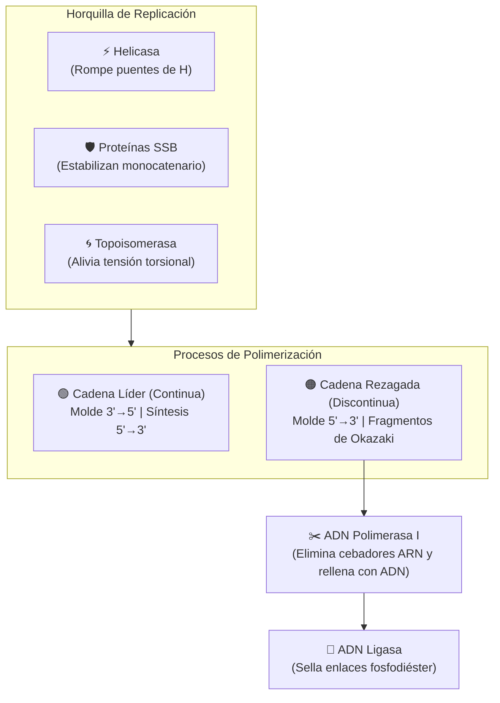

# Módulo de Replicación del ADN

La replicación es el proceso celular mediante el cual una molécula de ADN bicatenario se duplica de manera **semiconservativa**, dando lugar a dos moléculas de ADN hijas idénticas, cada una portando una hebra original parental y una hebra de nueva síntesis.

---

## 1. Fundamento Biológico y Maquinaria Molecular

La replicación celular está regida por dos restricciones moleculares fundamentales:
1. **Unidireccionalidad de síntesis**: Las ADN polimerasas **únicamente pueden sintetizar en dirección $5' \to 3'$**, requiriendo un extremo $3'\text{-OH}$ libre preexistente para incorporar nuevos desoxirribonucleótidos (dNTPs).
2. **Antiparalelismo**: La doble hélice de ADN está compuesta por dos cadenas antiparalelas ($5' \to 3'$ y $3' \to 5'$).



### Cuadro de Enzimas y Factores Simulados

| Enzima / Factor | Función Biológica en la Célula | Representación en el Simulador |
| :--- | :--- | :--- |
| **Helicasa** | Rompe los puentes de hidrógeno entre pares de bases para abrir la horquilla. | Separa la doble cadena y expone las hebras molde. |
| **Topoisomerasa / Girasa** | Alivia la tensión superhelicoidal por delante de la horquilla. | Registra la desestabilización torsional previa al avance. |
| **Proteínas SSB** | Evitan que las cadenas sencillas abiertas vuelvan a aparearse. | Mantiene las cadenas molde disponibles para la síntesis. |
| **ARN Primasa** | Sintetiza cebadores (*primers*) de ARN cortos con un grupo $3'\text{-OH}$ libre. | Genera oligoribonucleótidos complementarios ($3\text{ pb}$). |
| **ADN Polimerasa III** | Sintetiza la cadena continua líder y los tramos de ADN en los fragmentos de Okazaki. | Elonga en sentido $5' \to 3'$ a partir de cada cebador. |
| **ADN Polimerasa I** | Degrada cebadores de ARN (exonucleasa $5' \to 3'$) y rellena las brechas con ADN. | Reemplaza ribonucleótidos por desoxirribonucleótidos. |
| **ADN Ligasa** | Cataliza enlaces fosfodiéster covalentes entre fragmentos de Okazaki contiguos. | Sella las muescas (*nicks*) generando una cadena continua. |

---

## 2. La Asimetría de la Horquilla: Líder vs. Rezagada

Debido a que la horquilla de replicación se abre en una única dirección, las dos cadenas molde deben sintetizarse con estrategias completamente distintas:

### A. Cadena Líder (Adelantada / Continua)
* **Molde**: Hebra orientada en sentido $3' \to 5'$.
* **Mecanismo**: La ARN Primasa coloca **un único cebador** en el extremo inicial. A partir de él, la ADN Polimerasa III sintetiza de forma continua en dirección $5' \to 3'$, avanzando en el mismo sentido en que la Helicasa abre la horquilla.

### B. Cadena Rezagada (Retrasada / Discontinua)
* **Molde**: Hebra orientada en sentido $5' \to 3'$.
* **Mecanismo**: La polimerasa no puede avanzar en sentido contrario a la horquilla de forma continua. Por ello:
  1. A medida que la horquilla se abre, la ARN Primasa sintetiza **múltiples cebadores periódicos**.
  2. La ADN Polimerasa III sintetiza pequeños bloques de ADN llamados **Fragmentos de Okazaki**.
  3. Cada fragmento consta inicialmente de: $\text{[Cebador de ARN]} + \text{[Tramo de ADN recién sintetizado]}$.

!!! tip "Pregunta clave de examen / defensa"
    **¿Por qué la ADN polimerasa no puede sintetizar directamente en dirección $3' \to 5'$?**
    La síntesis celular utiliza la energía del enlace fosfoanhídrido de los dNTPs entrantes. Si una polimerasa sintetizara de $3' \to 5'$, la corrección de errores (actividad exonucleasa) eliminaría el nucleótido del extremo $5'$, destruyendo el grupo trifosfato de activación y bloqueando la elongación de la cadena.

---

## 3. Implementación Algorítmica en Python

El módulo [`replicacion.py`](#) encapsula toda la lógica de replicación dividiendo el proceso en etapas secuenciales y devolviendo un diccionario de estado detallado.

### A. Reglas de Complementariedad
Las reglas de apareamiento canónico se modelan mediante diccionarios en tiempo constante $O(1)$:

```python
# Apareamiento estándar ADN bicatenario: A=T, C≡G
COMPLEMENTO_ADN = {
    'A': 'T', 'T': 'A',
    'C': 'G', 'G': 'C'
}

# Síntesis de cebadores de ARN sobre molde de ADN: A→U, T→A, C→G, G→C
COMPLEMENTO_ARN = {
    'A': 'U', 'T': 'A',
    'C': 'G', 'G': 'C'
}
```

### B. Generación y Maduración de Fragmentos de Okazaki
En la cadena rezagada, el algoritmo itera sobre la hebra molde dividiéndola en ventanas discretas de longitud configurable (`tam_okazaki` y `tam_primer`):

```python
fragmentos_okazaki = []
inicio = 0
while inicio < longitud:
    fin = min(inicio + tam_okazaki, longitud)
    tramo_molde = cadena_5_3[inicio:fin]

    # 1. ARN Primasa: sintetiza cebador
    long_primer = min(tam_primer, len(tramo_molde))
    cebador_arn = "".join(COMPLEMENTO_ARN[b] for b in tramo_molde[:long_primer])

    # 2. ADN Polimerasa III: elongación de ADN
    adn_elongado = "".join(COMPLEMENTO_ADN[b] for b in tramo_molde[long_primer:])

    # 3. ADN Polimerasa I + Ligasa: reemplazo a ADN y unión
    adn_maduro = "".join(COMPLEMENTO_ADN[b] for b in tramo_molde)

    fragmentos_okazaki.append({
        "cebador_arn": cebador_arn,
        "adn_sintetizado": adn_elongado,
        "dna_maduro": adn_maduro
    })
    inicio = fin
```

---

## 4. Trazabilidad en Consola y Salida del Simulador

Durante la ejecución, el simulador muestra paso a paso las tarjetas de actividad enzimática:

```text
┌── [ ENZIMA / FACTOR: Helicasa + Topoisomerasa + SSB ] ─────────────────────────────
│ Etapa: [1/5] Iniciación de la horquilla
│ La Helicasa rompe los puentes de hidrógeno, abriendo la doble hélice.
│ La Topoisomerasa alivia la tensión torsional y las SSB estabilizan las hebras.
│
│ Representación molecular en tiempo real:
│   5'- ATGGCCAACGTACGTTCAGATGAAGCCTACTAA -3'  (Molde Cadena Rezagada)
│                        <--- Horquilla abierta por Helicasa
│   3'- TACCGGTTGCATGCAAGTCTACTTCGGATGATT -5'  (Molde Cadena Líder)
└───────────────────────────────────────────────────────────────────────────────────

┌── [ ENZIMA / FACTOR: ARN Primasa + ADN Polimerasa III ] ───────────────────────────
│ Etapa: [3/5] Cadena Rezagada - Fragmentos de Okazaki
│ La síntesis es discontinua en sentido contrario al avance de la horquilla.
│ Se sintetizan múltiples cebadores de ARN seguidos de ADN.
│
│ Representación molecular en tiempo real:
│   Molde Rezagada : 5'- ATGGCCAACGTACGTTCAGATGAAGCCTACTAA -3'
│   Síntesis Okazaki: [Okz#1: 5'-[UAC]-CGGTTGC-3']  [Okz#2: 5'-[AUG]-CAAGUC-3'] ...
└───────────────────────────────────────────────────────────────────────────────────

┌── [ ENZIMA / FACTOR: ADN Ligasa ] ────────────────────────────────────────────────
│ Etapa: [5/5] Sellado de Muescas (Ligation)
│ La ADN Ligasa cataliza los enlaces fosfodiéster uniendo los fragmentos contiguos.
│
│ Representación molecular en tiempo real:
│   Cadena Rezagada Sellada: 3'- TACCGGTTGCATGCAAGTCTACTTCGGATGATT -5'
│   Molde Original         : 5'- ATGGCCAACGTACGTTCAGATGAAGCCTACTAA -3'
│   ¡Cadena continua completada con éxito!
└───────────────────────────────────────────────────────────────────────────────────
```

---

## 5. Demostración Semiconservativa

Al finalizar la etapa de replicación, el sistema valida que las dos moléculas hijas contienen exactamente una hebra parental y una hebra sintetizada de novo:

$$\text{Molécula 1} = \text{Parental (5'→3')} + \text{Rezagada Nueva (3'→5')}$$

$$\text{Molécula 2} = \text{Parental (3'→5')} + \text{Líder Nueva (5'→3')}$$

Ambos dúplex son completamente idénticos en secuencia, preservando fielmente la información genética celular.
