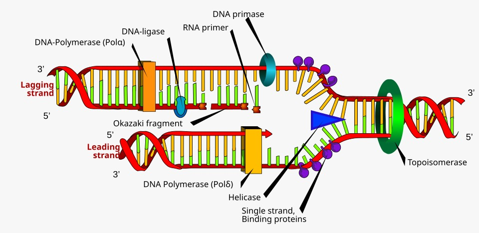

# Replicación del ADN: Fundamento Teórico y Flujo del Simulador

La **replicación del ADN** es el mecanismo molecular que permite a una célula duplicar su material genético con alta fidelidad antes de dividirse, asegurando que cada célula hija reciba una copia idéntica del genoma.



## 1. Contexto Teórico

### Principios Biológicos Fundamentales

El proceso de replicación en organismos vivos se rige por tres principios inquebrantables:

1. **Carácter Semiconservativo**: Cada una de las dos moléculas de ADN hijas resultantes conserva una hebra original de la molécula madre (hebra parental) y una hebra de nueva síntesis.
2. **Unidireccionalidad ($5' \to 3'$)**: Las ADN polimerasas únicamente son capaces de catalizar la adición de desoxirribonucleótidos al grupo hidroxilo libre en el extremo $3'\text{-OH}$ de una cadena en crecimiento. Ninguna polimerasa celular puede sintetizar en sentido $3' \to 5'$.
3. **Antiparalelismo y Asimetría**: Las dos hebras de la doble hélice discurren en orientaciones opuestas ($5' \to 3'$ y $3' \to 5'$). Al abrirse la horquilla en un único sentido, se genera una asimetría obligada:
    - **Cadena Líder (continua)**: Se sintetiza de manera ininterrumpida en la misma dirección en que avanza la horquilla.
    - **Cadena Rezagada (discontinua)**: Se sintetiza en dirección contraria al avance de la horquilla mediante tramos cortos denominados **Fragmentos de Okazaki**.

[//]: # (```mermaid)

[//]: # (flowchart LR)

[//]: # (    subgraph Horquilla["Apertura y Estabilización"])

[//]: # (        H["Helicasa<br>&#40;Rompe puentes de H&#41;"])

[//]: # (        T["Topoisomerasa<br>&#40;Alivia tensión torsional&#41;"])

[//]: # (        S["Proteínas SSB<br>&#40;Evitan reasociación&#41;"])

[//]: # (    end)

[//]: # ()
[//]: # (    subgraph Sintesis["Polimerización"])

[//]: # (        Lider["Cadena Líder<br>&#40;Síntesis continua 5'→3'&#41;"])

[//]: # (        Rezagada["Cadena Rezagada<br>&#40;Fragmentos de Okazaki 5'→3'&#41;"])

[//]: # (    end)

[//]: # ()
[//]: # (    subgraph Maduracion["Maduración y Sellado"])

[//]: # (        PolI["ADN Polimerasa I<br>&#40;Retira ARN cebador y rellena con ADN&#41;"])

[//]: # (        Lig["ADN Ligasa<br>&#40;Sella enlaces fosfodiéster&#41;"])

[//]: # (    end)

[//]: # ()
[//]: # (    Horquilla --> Sintesis --> Maduracion)

[//]: # (```)

### La Maquinaria Enzimática

| Enzima / Factor | Función Biológica Principal |
| :--- | :--- |
| **Helicasa** | Rompe los puentes de hidrógeno entre pares de bases para abrir la doble hélice. |
| **Topoisomerasa (Girasa)** | Corta transitoriamente el esqueleto fosfodiéster para liberar el superenrollamiento torsional. |
| **Proteínas SSB** | Se unen a las cadenas monocatenarias expuestas para evitar que se reasocien o degraden. |
| **ARN Primasa** | Sintetiza oligonucleótidos cortos de ARN (*cebadores* o *primers*) que ofrecen el extremo $3'\text{-OH}$ inicial. |
| **ADN Polimerasa III** | Principal enzima de elongación; replica la cadena continua y los fragmentos de Okazaki en sentido $5' \to 3'$. |
| **ADN Polimerasa I** | Posee actividad exonucleasa $5' \to 3'$: degrada los cebadores de ARN y los sustituye por ADN. |
| **ADN Ligasa** | Cataliza el enlace fosfodiéster covalente entre fragmentos vecinos sellando las muescas (*nicks*). |


## 2. Flujo de Ejecución en `replicacion.py`

A continuación se detalla paso a paso cómo está implementado el simulador en el archivo [`replicacion.py`](https://github.com/Ayoze/BIO-simulacion-dogma-central/blob/main/replicacion.py). Cada paso muestra el fragmento de código correspondiente, una explicación breve de su función bioinformática y su representación gráfica.


### Paso 1: Diccionarios de Complementariedad Molecular

Para modelar la interacción química entre nucleótidos, el módulo define tablas de equivalencia directa:

```python
# Reglas de complementariedad para ADN: A <-> T, C <-> G
COMPLEMENTO_ADN = {
    'A': 'T', 'T': 'A',
    'C': 'G', 'G': 'C',
    'a': 't', 't': 'a',
    'c': 'g', 'g': 'c'
}

# Complementariedad para síntesis de ARN primer: ADN -> ARN (A->U, T->A, C->G, G->C)
COMPLEMENTO_ARN = {
    'A': 'U', 'T': 'A',
    'C': 'G', 'G': 'C',
    'a': 'u', 't': 'a',
    'c': 'g', 'g': 'c'
}
```

**Explicación:**  
Se emplean dos mapeos fundamentales: `COMPLEMENTO_ADN` replica el apareamiento canónico de Watson-Crick ($A=T$ con 2 puentes de hidrógeno y $C \equiv G$ con 3 puentes). Por su parte, `COMPLEMENTO_ARN` simula la acción de la ARN Primasa, incorporando **Uracilo (U)** en lugar de Timina cuando el molde presenta Adenina.


### Paso 2: Determinación de la Hebra Antiparalela Molde

Antes de abrir la horquilla, el algoritmo identifica ambas cadenas parentales según la orientación provista por el usuario:

```python
def obtener_cadena_complementaria(cadena_adn: str) -> str:
    """Devuelve la cadena complementaria de ADN respetando A-T y C-G."""
    return "".join(COMPLEMENTO_ADN.get(base.upper(), 'N') for base in cadena_adn)

# Dentro de simular_replicacion:
if es_5a3:
    cadena_5_3 = cadena_adn
    cadena_3_5 = obtener_cadena_complementaria(cadena_5_3)
else:
    cadena_3_5 = cadena_adn
    cadena_5_3 = obtener_cadena_complementaria(cadena_3_5)
```

**Explicación:**  
Si la secuencia de entrada se suministra en dirección $5' \to 3'$, la hebra complementaria correspondiente estará orientada en sentido $3' \to 5'$. Esto define cuál de las dos actuará como molde para la síntesis continua y cuál para la síntesis discontinua.


### Paso 3: Síntesis de la Cadena Líder (Continua)

Con la horquilla abierta, se simula la replicación directa de la hebra con orientación molde $3' \to 5'$:

```python
# Molde: Hebra 3' -> 5' (cadena_3_5)
# Síntesis: Se realiza de forma continua en sentido 5' -> 3' avanzando hacia la horquilla.
primer_lider = "".join(COMPLEMENTO_ARN[b] for b in cadena_3_5[:tam_primer])
adn_lider_restante = "".join(COMPLEMENTO_ADN[b] for b in cadena_3_5[tam_primer:])
cadena_lider_completa = "".join(COMPLEMENTO_ADN[b] for b in cadena_3_5)
```

**Explicación:**  
Como la ADN Polimerasa III lee el molde en sentido $3' \to 5'$, puede sintetizar de forma continua en dirección $5' \to 3'$. Solo requiere un **único cebador inicial** colocado por la ARN Primasa para arrancar la elongación hasta el final de la cadena.

### Paso 4: Síntesis Discontinua de la Cadena Rezagada (Okazaki)

Para la hebra parental con orientación $5' \to 3'$, la polimerasa no puede avanzar en la misma dirección que la horquilla:

```python
fragmentos_okazaki = []
num_fragmento = 1

# Recorremos el molde 5'->3' fragmentándolo en bloques discretos
for inicio in range(0, longitud, tam_okazaki):
    fin = max(0, inicio + tam_okazaki)
    tramo_molde_5a3 = cadena_5_3[inicio:fin]
    tramo_molde_3a5 = tramo_molde_5a3[::-1]

    long_primer_frag = min(tam_primer, len(tramo_molde_3a5))
    # Cebador de ARN sintetizado en sentido 5' -> 3'
    sub_primer_arn = "".join(COMPLEMENTO_ARN[b] for b in tramo_molde_3a5[:long_primer_frag])
    # ADN elongado en sentido 5' -> 3' por ADN Polimerasa III
    sub_adn = "".join(COMPLEMENTO_ADN[b] for b in tramo_molde_3a5[long_primer_frag:])
    secuencia_total_okazaki = sub_primer_arn + sub_adn
    secuencia_dna_maduro = "".join(COMPLEMENTO_ADN[b] for b in tramo_molde_3a5)

    num_fragmento += 1
```

**Explicación:**  
El código divide la cadena en fragmentos (`tam_okazaki`). Cada bloque se lee localmente en sentido $3' \to 5'$, generando un cebador de ARN específico con la Primasa y elongando un segmento de ADN con la Polimerasa III. El resultado es una serie de fragmentos discretos orientados cada uno en $5' \to 3'$.


### Paso 5: Maduración de Cebadores (ADN Polimerasa I)

Una vez completada la elongación, los cebadores de ARN deben ser eliminados de ambas cadenas:

```python
primer_lider_adn = primer_lider.replace('U', 'T')
# Para la cadena rezagada, se hizo el cambio en pasos anteriores
```

**Explicación:**  
La **ADN Polimerasa I** utiliza su actividad exonucleasa $5' \to 3'$ para degradar el ARN ribonucleotídico y reemplazarlo por desoxirribonucleótidos de ADN (cambiando $U$ por $T$). Aunque las bases son ahora todas de ADN, aún no existe un enlace fosfodiéster que una físicamente los fragmentos contiguos (quedan *muescas* o *nicks*).


### Paso 6: Sellado Covalente de Muescas (ADN Ligasa)

Para finalizar la síntesis de la hebra discontinua, los fragmentos de Okazaki maduros deben ligarse covalentemente:

```python
cadena_rezagada_sellada_5a3 = "".join(f["dna_maduro"] for f in fragmentos_okazaki)
```

**Explicación:**  
La **ADN Ligasa** consume un cofactor energético ($NAD^+$ o $ATP$) para condensar el grupo fosfato terminal con el hidroxilo vecino, consolidando el esqueleto de azúcar-fosfato y convirtiendo la serie de fragmentos en una hebra de ADN totalmente continua.


