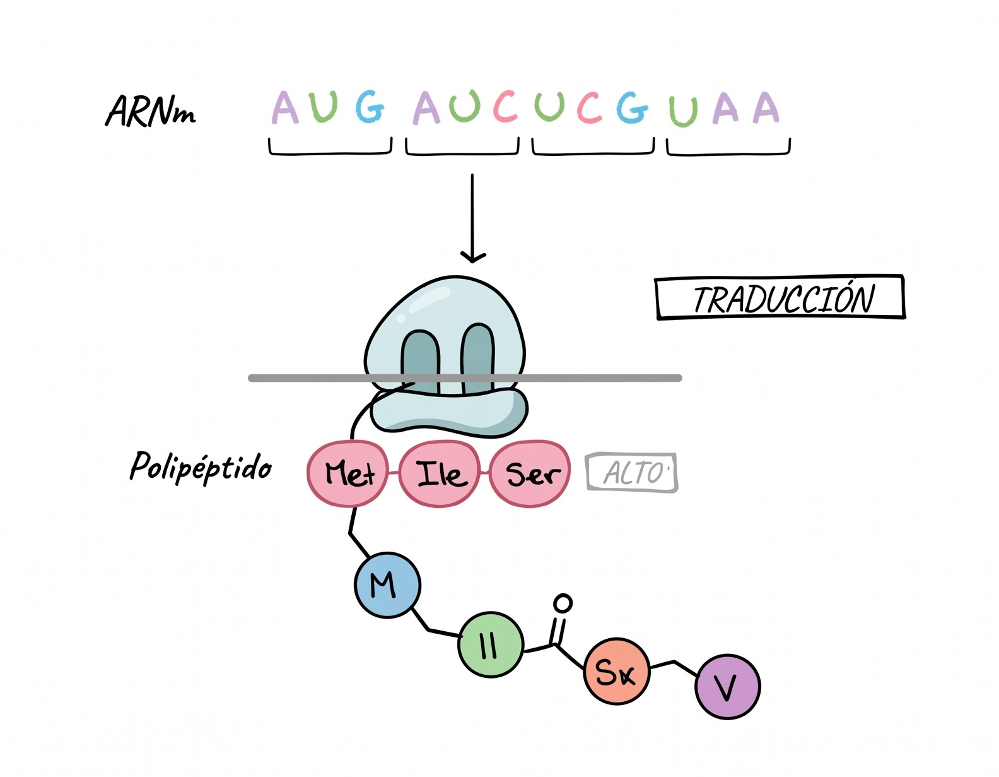

# Traducción del ARNm: Fundamento Teórico y Transformación de Cadenas

La **traducción** es la etapa culminante de la expresión génica según el Dogma Central, en la cual la secuencia de ribonucleótidos del **ARN mensajero (ARNm)** se decodifica en los ribosomas para ensamblar una secuencia lineal de aminoácidos (**cadena polipeptídica o proteína**).



## 1. Contexto Teórico

### Principios Biológicos Clave

1. **Lectura por Tripletes (Codones)**: La información del ARNm se lee de 3 en 3 nucleótidos de forma continua, no solapante y sin signos de puntuación, en dirección **$5' \to 3'$**.
2. **Direccionalidad Peptídica**: La síntesis de la proteína se efectúa estrictamente desde el **extremo Amino-terminal ($N\text{-terminal}$)** hacia el **extremo Carboxilo-terminal ($C\text{-terminal}$)**.
3. **El Código Genético Universal**:
    - **64 codones posibles** ($4^3$), de los cuales 61 codifican aminoácidos y 3 son codones de parada (*Stop*).
    - **Codón de Inicio Universal**: **`AUG`**, que codifica para **Metionina (Met)** y define el marco abierto de lectura (*Open Reading Frame - ORF*).
    - **Codones de Parada (*Stop*)**: **`UAA`**, **`UAG`** y **`UGA`**, que provocan el fin de la traducción.
    - **Degenerado o redundante**: Varios codones pueden codificar para el mismo aminoácido.
4. **Acoplamiento Codón-Anticodón**: Las moléculas de **ARN de transferencia (ARNt)** actúan como adaptadores moleculares portando un aminoácido en su extremo $3'$ y un **anticodón** complementario y antiparalelo ($3' \to 5'$) que reconoce el codón del ARNm ($5' \to 3'$).

```text
ARNm (5'→3')       :  5'-  A     U     G  -3'   (Codón de Inicio)
                           |     |     |        (Apareamiento antiparalelo)
ARNt Anticodón     :  3'-  U     A     C  -5'   (Met-ARNt)
                           \___________/
Aminoácido cargado :      [ Metionina ]  --> Extremo N-terminal de la proteína
```

### Dinámica de los Sitios Ribosomales

| Sitio Ribosomal | Nombre Biológico | Función Molecular |
| :---: | :--- | :--- |
| **Sitio A** | **Aminoacilo** (*Aminoacyl*) | Recepción del nuevo aminoacil-ARNt según el codón expuesto. |
| **Sitio P** | **Peptidilo** (*Peptidyl*) | Retención del peptidil-ARNt y catálisis del enlace peptídico por la peptidil transferasa. |
| **Sitio E** | **Salida** (*Exit*) | Expulsión del ARNt desacilado tras la translocación del ribosoma. |


## 2. Desglose de Transformación de Cadenas en `traduccion.py`

A continuación se detalla exclusivamente la lógica de manipulación de cadenas implementada en [`traduccion.py`](https://github.com/Ayoze/BIO-simulacion-dogma-central/blob/main/traduccion.py).


### Paso 1: Definición de la Tabla del Código Genético y Mapeo Antiparalelo

Para decodificar secuencias de ARN, el módulo define el código genético completo y las reglas de complementariedad de ribonucleótidos:

```python
# Mapeo del código genético universal: codon -> (codigo_3, codigo_1, nombre, propiedad)
TABLA_CODIGO_GENETICO = {
    'AUG': ('Met', 'M', 'Metionina (INICIO)', 'Apolar / Inicio universal'),
    'UUU': ('Phe', 'F', 'Fenilalanina', 'Apolar / Hidrófobo'),
    'UAA': ('STOP', '*', 'Codón de Parada (Ocre)', 'Señal de Terminación'),
    'UAG': ('STOP', '*', 'Codón de Parada (Ámbar)', 'Señal de Terminación'),
    'UGA': ('STOP', '*', 'Codón de Parada (Ópalo)', 'Señal de Terminación'),
    # ... total de 64 codones
}

# Reglas de complementariedad entre ARN mensajero y ARN de transferencia
COMPLEMENTO_ARN = {
    'A': 'U', 'U': 'A',
    'C': 'G', 'G': 'C'
}
```

**Explicación:**  
Cada triplete posible de nucleótidos de ARNm se asocia en $O(1)$ con su aminoácido correspondiente en nomenclatura de 3 letras, 1 letra y propiedades químicas. A su vez, `COMPLEMENTO_ARN` define la interacción entre ribonucleótidos ($A=U$ y $C \equiv G$) requerida para deducir el anticodón del ARNt.

```text
[ Triplete ARNm (5'->3') ]           [ Decodificación a Aminoácido ]
         AUG              =======>    Met (M)  [Inicio]
         GCC              =======>    Ala (A)  [Apolar]
         AAC              =======>    Asn (N)  [Polar neutro]
         UAA / UAG / UGA  =======>    STOP (*) [Terminación]
```


### Paso 2: Generación del Anticodón Antiparalelo del ARNt

La interacción entre el codón expuesto en el ribosoma y el ARNt adaptador exige calcular la secuencia antiparalela del anticodón:

```python
def obtener_anticodon(codon: str) -> str:
    """
    Obtiene el anticodón de ARNt antiparalelo (3' -> 5') correspondiente al codón (5' -> 3').
    Ejemplo: Codón 5'-AUG-3' -> Anticodón 3'-UAC-5'.
    """
    return "".join(COMPLEMENTO_ARN.get(b, 'N') for b in codon)
```

**Explicación:**  
La función recibe una subcadena de tres caracteres correspondiente a un codón ($5' \to 3'$) y la transforma base a base en su secuencia complementaria. Esta cadena resultante representa el anticodón leído en sentido $3' \to 5'$, garantizando el apareamiento antiparalelo exacto dentro del ribosoma.

```text
Codón ARNm (5'->3')      :   5'-   A       U       G   -3'
                                   |       |       |   (Complementariedad de ARN)
Anticodón ARNt (3'->5')  :   3'-   U       A       C   -5'
                                   \_______________/
                                    Met-ARNt cargado
```


### Paso 3: Identificación del Marco Abierto de Lectura (Búsqueda de `AUG`)

Antes de traducir de tres en tres nucleótidos, el algoritmo debe descartar la región no traducida ($5'\text{-UTR}$) y fijar el marco de lectura en el primer triplete `AUG`:

```python
arnm = arnm_5_3.upper().strip()

indice_inicio = arnm.find("AUG")

if indice_inicio != -1:
    arn_5_utr = arnm[:indice_inicio]
    arn_orf = arnm[indice_inicio:]
```

**Explicación:**  
`arnm.find("AUG")` localiza el índice de la primera ocurrencia de la señal de inicio de traducción. Mediante *slicing*, la cadena se subdivide en dos tramos: `arn_5_utr`, que abarca los nucleótidos previos al inicio que el ribosoma escanea sin traducir, y `arn_orf`, que constituye el marco abierto de lectura a procesar.

```text
Cadena ARNm:  5'-  G  G  A  C  U  [ A  U  G ]  C  G  A  U  C  U  A  G  -3'
                   \___________/  \___________________________________/
                     5'-UTR            Marco Abierto de Lectura (ORF)
                  (No traducido)          (Inicia traducción aquí)
```


### Paso 4: Bucle de Elongación y Detección de Codones de Parada

Una vez establecido el marco de lectura, el algoritmo itera en ventanas discretas de 3 nucleótidos hasta encontrar una señal de término o el final de la cadena:

```python
i = indice_inicio
aminoacidos_3 = []
aminoacidos_1 = []

while i + 3 <= len(arnm):
    triplete = arnm[i:i+3]
    info_aa = TABLA_CODIGO_GENETICO.get(triplete, ('???', '?', 'Desconocido', 'Desconocido'))
    codigo_3, codigo_1, nombre, propiedad = info_aa
    anticodon = obtener_anticodon(triplete)

    if codigo_3 == 'STOP':
        codon_stop_encontrado = True
        break

    aminoacidos_3.append(codigo_3)
    aminoacidos_1.append(codigo_1)
    i += 3
```

**Explicación:**  
El puntero `i` avanza en saltos de 3 posiciones (`i += 3`), simulando la translocación del ribosoma. Para cada triplete, consulta `TABLA_CODIGO_GENETICO`. Si el triplete corresponde a uno de los tres codones de parada (`STOP`), el bucle se interrumpe inmediatamente emulando la acción de los factores de liberación. De lo contrario, almacena el aminoácido en las listas acumuladoras.

```text
Ciclo 1 (i=0) :  5'-[AUG]-3'  -->  Met (M)  -->  Anticodón 3'-UAC-5'
Ciclo 2 (i=3) :  5'-[CGA]-3'  -->  Arg (R)  -->  Anticodón 3'-GCU-5'
Ciclo 3 (i=6) :  5'-[UCG]-3'  -->  Ser (S)  -->  Anticodón 3'-AGC-5'
Ciclo 4 (i=9) :  5'-[UAG]-3'  -->  STOP     -->  ¡Fin de traducción! (Break)
```


### Paso 5: Ensamblaje de la Cadena Polipeptídica Final

Finalizada la lectura de codones, las listas de aminoácidos se unen para conformar la representación química de la proteína:

```python
# Polipéptido formal con extremos Amino y Carboxilo terminales
cadena_proteica = f"H2N- {' - '.join(aminoacidos_3)} -COOH" if aminoacidos_3 else "Cadena vacía"

# Secuencia condensada en notación de una letra (estándar FASTA)
secuencia_fasta = "".join(aminoacidos_1)
```

**Explicación:**  
Se generan dos cadenas de salida: `cadena_proteica`, que concatena los códigos de 3 letras mediante enlaces tipo ` - ` respetando los extremos terminales biológicos ($\text{H}_2\text{N}-$ en el extremo $5'$ del ARNm y $-\text{COOH}$ en el extremo $3'$), y `secuencia_fasta`, que condensa los monómeros en una sola cadena de texto alfanumérico según el estándar bioinformático internacional.

```text
Secuencia en 3 letras:  H2N- Met - Arg - Ser - Ala - Tyr -COOH
                        (N-terminal)                   (C-terminal)

Secuencia FASTA (1L) :  MRSAY
```
