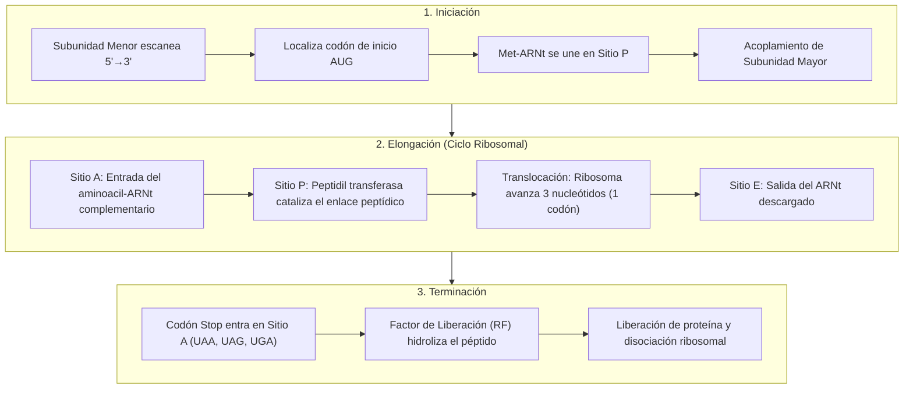

# Módulo de Traducción y Síntesis de Proteínas

La traducción es la etapa culminante del Dogma Central, en la cual la información genética contenida en el **ARN mensajero (ARNm)** se descodifica para sintetizar una cadena polipeptídica específica (**proteína**). Este proceso implica la transición del lenguaje nucleotídico (4 bases) al lenguaje de los aminoácidos (20 monómeros).

---

## 1. Fundamento Biológico y Maquinaria Molecular

La síntesis de proteínas tiene lugar en los **ribosomas** celulares y procede siempre con una polaridad estricta: desde el extremo **Amino-terminal ($N\text{-terminal}$)** hacia el extremo **Carboxilo-terminal ($C\text{-terminal}$)**.



### Los Tres Sitios Funcionales del Ribosoma

El ribosoma dispone de tres cavidades activas clave para coordinar la lectura del ARNm y la polimerización de aminoácidos:

| Sitio Ribosomal | Nombre Biológico | Función Molecular |
| :---: | :--- | :--- |
| **Sitio A** | **Aminoacilo** (*Aminoacyl*) | Punto de entrada donde se acomoda el nuevo ARNt cargado con su aminoácido específico, verificando el apareamiento codón-anticodón. |
| **Sitio P** | **Peptidilo** (*Peptidyl*) | Retiene el ARNt unido a la cadena polipeptídica en crecimiento. Aquí reside la actividad catalítica de la **peptidil transferasa**. |
| **Sitio E** | **Salida** (*Exit*) | Aloja transitoriamente al ARNt desacilado (sin aminoácido) antes de ser expulsado al citoplasma para su posterior recarga. |

---

## 2. El Código Genético Universal

El código genético establece las reglas de correspondencia entre tripletes de nucleótidos (**codones**) y los aminoácidos incorporados:

* **Tripletes**: $4^3 = 64$ combinaciones posibles de codones.
* **Codón de Inicio Universal**: **`AUG`**, que codifica para **Metionina (Met)** y define el marco abierto de lectura (*Open Reading Frame - ORF*).
* **Codones de Parada (*Stop*)**: **`UAA`** (Ocre), **`UAG`** (Ámbar) y **`UGA`** (Ópalo). No codifican ningún aminoácido; son reconocidos por factores de liberación proteicos.

### Propiedades Biológicas Esenciales

1. **Universalidad**: Con mínimas excepciones evolutivas, el mismo codón codifica para el mismo aminoácido en prácticamente todas las formas de vida.
2. **Degeneración o Redundancia**: Existen 61 codones con sentido para solo 20 aminoácidos. Varios aminoácidos están codificados por más de un codón (ej. Leucina y Arginina cuentan con 6 codones cada una).
3. **No solapante y sin puntuación**: La lectura se realiza de forma continua de 3 en 3 nucleótidos a partir del codón AUG, sin espacios ni omisiones.

???+ note "Tabla Completa del Código Genético Universal (64 codones)"
    | 1ª Base | 2ª Base: U | 2ª Base: C | 2ª Base: A | 2ª Base: G | 3ª Base |
    | :---: | :--- | :--- | :--- | :--- | :---: |
    | **U** | UUU - Phe (F)<br>UUC - Phe (F)<br>UUA - Leu (L)<br>UUG - Leu (L) | UCU - Ser (S)<br>UCC - Ser (S)<br>UCA - Ser (S)<br>UCG - Ser (S) | UAU - Tyr (Y)<br>UAC - Tyr (Y)<br>**UAA - STOP**<br>**UAG - STOP** | UGU - Cys (C)<br>UGC - Cys (C)<br>**UGA - STOP**<br>UGG - Trp (W) | **U**<br>**C**<br>**A**<br>**G** |
    | **C** | CUU - Leu (L)<br>CUC - Leu (L)<br>CUA - Leu (L)<br>CUG - Leu (L) | CCU - Pro (P)<br>CCC - Pro (P)<br>CCA - Pro (P)<br>CCG - Pro (P) | CAU - His (H)<br>CAC - His (H)<br>CAA - Gln (Q)<br>CAG - Gln (Q) | CGU - Arg (R)<br>CGC - Arg (R)<br>CGA - Arg (R)<br>CGG - Arg (R) | **U**<br>**C**<br>**A**<br>**G** |
    | **A** | AUU - Ile (I)<br>AUC - Ile (I)<br>AUA - Ile (I)<br>**AUG - Met (M) [INICIO]** | ACU - Thr (T)<br>ACC - Thr (T)<br>ACA - Thr (T)<br>ACG - Thr (T) | AAU - Asn (N)<br>AAC - Asn (N)<br>AAA - Lys (K)<br>AAG - Lys (K) | AGU - Ser (S)<br>AGC - Ser (S)<br>AGA - Arg (R)<br>AGG - Arg (R) | **U**<br>**C**<br>**A**<br>**G** |
    | **G** | GUU - Val (V)<br>GUC - Val (V)<br>GUA - Val (V)<br>GUG - Val (V) | GCU - Ala (A)<br>GCC - Ala (A)<br>GCA - Ala (A)<br>GCG - Ala (A) | GAU - Asp (D)<br>GAC - Asp (D)<br>GAA - Glu (E)<br>GAG - Glu (E) | GGU - Gly (G)<br>GGC - Gly (G)<br>GGA - Gly (G)<br>GGG - Gly (G) | **U**<br>**C**<br>**A**<br>**G** |

!!! tip "Pregunta clave de examen / defensa"
    **¿Por qué el ARNt iniciador (Met-ARNt) ingresa directamente en el Sitio P y no en el Sitio A?**
    Es el único ARNt que tiene esta propiedad biológica. Entra al sitio P durante la fase de iniciación para dejar el **Sitio A libre**, permitiendo que el segundo aminoacil-ARNt pueda ingresar y la peptidil transferasa forme el **primer enlace peptídico**. Si entrara al sitio A, no existiría ningún extremo peptidil con el que formar enlace.

---

## 3. Implementación Algorítmica en Python

El módulo [`traduccion.py`](#) implementa la traducción procesando rigurosamente los marcos de lectura:

### A. Diccionario de Descodificación con Propiedades Bioquímicas
El código modela no solo los aminoácidos, sino también su abreviatura internacional y su naturaleza fisicoquímica:

```python
TABLA_CODIGO_GENETICO = {
    'AUG': ('Met', 'M', 'Metionina (INICIO)', 'Apolar / Inicio universal'),
    'GCC': ('Ala', 'A', 'Alanina', 'Apolar / Hidrófobo'),
    'AAC': ('Asn', 'N', 'Asparagina', 'Polar neutro'),
    'GUA': ('Val', 'V', 'Valina', 'Apolar / Hidrófobo'),
    'CGU': ('Arg', 'R', 'Arginina', 'Carga positiva / Básico'),
    'GAU': ('Asp', 'D', 'Aspartato', 'Carga negativa / Ácido'),
    'UAA': ('STOP', '*', 'Codón de Parada (Ocre)', 'Señal de Terminación'),
    # ... los 64 codones implementados
}
```

### B. El Bucle de Elongación y Translocación
El algoritmo localiza el primer codón `AUG` y avanza de 3 en 3 nucleótidos modelando la dinámica ribosomal:

```python
i = indice_inicio
while i + 3 <= len(arnm):
    triplete = arnm[i:i+3]
    codigo_3, codigo_1, nombre, propiedad = TABLA_CODIGO_GENETICO[triplete]
    anticodon = obtener_anticodon(triplete)  # Apareamiento antiparalelo 3'->5'

    if codigo_3 == 'STOP':
        # Factor de liberación reconoce el codón y finaliza la síntesis
        break

    aminoacidos_3.append(codigo_3)
    i += 3  # Translocación: avance de 1 codón hacia el extremo 3'
```

---

## 4. Trazabilidad en Consola y Salida del Simulador

Durante la traducción, la CLI desglosa el comportamiento del ribosoma en tiempo real:

```text
┌── [ ENZIMA / FACTOR: Complejo Ribosomal + ARNt iniciador (Met-ARNt) ] ─────────────
│ Etapa: Iniciación de la Traducción
│ La subunidad menor escanea hasta hallar AUG. El Met-ARNt acopla su anticodón (3'-UAC-5').
│ La subunidad mayor se ensambla ubicando el iniciador en el Sitio P.
│
│ Representación molecular en tiempo real:
│   ARNm 5'-UTR : 5'- [] (Región no traducida)
│   Codón Inicio: [ AUG ] en posición 1
│   Ribosoma    : [Sitio E: Vacío] [Sitio P: Met-ARNt (UAC)] [Sitio A: Abierto]
└───────────────────────────────────────────────────────────────────────────────────

┌── [ ENZIMA / FACTOR: Peptidil Transferasa + ARNt específico ] ─────────────────────
│ Etapa: Elongación - Ciclo #5 (Codón CGU)
│ - Sitio A: Ingresa ARNt portando 'Arg' (Arginina) con anticodón 3'-GCA-5'.
│ - Sitio P: La Peptidil Transferasa cataliza el enlace peptídico.
│ - Translocación: El ribosoma avanza 3 nucleótidos hacia 3'. El ARNt usado sale por Sitio E.
│
│ Representación molecular en tiempo real:
│   ARNm leído     : ... [ CGU ] ...
│   Anticodón ARNt : ... [ 3'-GCA-5' ] cargando Arg
│   Cadena naciente: H2N- Met - Ala - Asn - Val - Arg -COOH
└───────────────────────────────────────────────────────────────────────────────────

┌── [ ENZIMA / FACTOR: Factor de Liberación (Release Factor - RF) ] ─────────────────
│ Etapa: Terminación de la Traducción
│ Codón de Parada encontrado: UAA (Codón de Parada (Ocre)).
│ El Factor RF hidroliza el polipéptido y provoca la disociación ribosomal completa.
│
│ Representación molecular en tiempo real:
│   Proteína Sintetizada: H2N- Met - Ala - Asn - Val - Arg - Ser - Asp - Glu - Ala - Tyr -COOH
│   Secuencia 1-letra   : MANVRSDEAY
│   Longitud            : 10 aminoácidos sintetizados.
└───────────────────────────────────────────────────────────────────────────────────
```

### Desglose de Codones y Propiedades de los Aminoácidos

| Ciclo | Codón (ARNm $5' \to 3'$) | Anticodón (ARNt $3' \to 5'$) | Aminoácido | Propiedad Química |
| :---: | :---: | :---: | :---: | :--- |
| **#1** | `5'- AUG -3'` | `3'- UAC -5'` | **Met (M)** | Apolar / Inicio universal |
| **#2** | `5'- GCC -3'` | `3'- CGG -5'` | **Ala (A)** | Apolar / Hidrófobo |
| **#3** | `5'- AAC -3'` | `3'- UUG -5'` | **Asn (N)** | Polar neutro |
| **#4** | `5'- GUA -3'` | `3'- CAU -5'` | **Val (V)** | Apolar / Hidrófobo |
| **#5** | `5'- CGU -3'` | `3'- GCA -5'` | **Arg (R)** | Carga positiva / Básico |
| **#6** | `5'- UCA -3'` | `3'- AGU -5'` | **Ser (S)** | Polar neutro |
| **#7** | `5'- GAU -3'` | `3'- CUA -5'` | **Asp (D)** | Carga negativa / Ácido |
| **#8** | `5'- GAA -3'` | `3'- CUU -5'` | **Glu (E)** | Carga negativa / Ácido |
| **#9** | `5'- GCC -3'` | `3'- CGG -5'` | **Ala (A)** | Apolar / Hidrófobo |
| **#10**| `5'- UAC -3'` | `3'- AUG -5'` | **Tyr (Y)** | Polar neutro / Aromático |
| **#11**| `5'- UAA -3'` | `3'- --- -5'` | **STOP (*)** | Señal de Terminación |

---

## 5. El Producto Final: La Proteína Madura

El flujo culmina con la obtención de la secuencia peptídica completa:

$$\text{H}_2\text{N}-\text{Met}-\text{Ala}-\text{Asn}-\text{Val}-\text{Arg}-\text{Ser}-\text{Asp}-\text{Glu}-\text{Ala}-\text{Tyr}-\text{COOH}$$

$$\text{Secuencia FASTA (1 letra): } \mathbf{MANVRSDEAY}$$

De este modo se cierra el círculo del Dogma Central: desde una secuencia de nucleótidos de ADN original hasta una molécula funcional de proteína.
