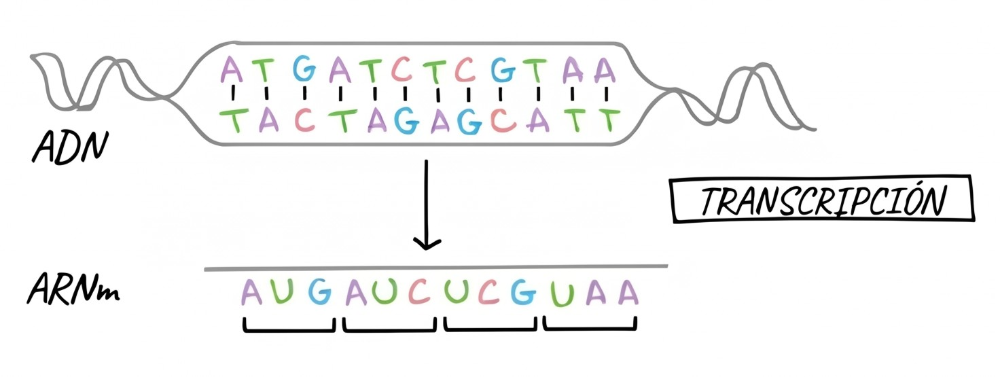

# Transcripción del ADN: Fundamento Teórico y Transformación de Cadenas

La **transcripción** es el proceso celular mediante el cual la secuencia de desoxirribonucleótidos de un gen se transfiere selectivamente a una molécula de **ARN mensajero (ARNm)** monocatenario. Este proceso constituye el primer paso fundamental en la expresión génica.



## 1. Contexto Teórico

### Principios Biológicos Clave

1. **Direccionalidad Estricta**: La ARN Polimerasa recorre la hebra molde físicamente en dirección $3' \to 5'$ y sintetiza la molécula de ARNm en sentido **$5' \to 3'$**.
2. **Síntesis *de novo***: A diferencia de las ADN polimerasas durante la replicación, la ARN polimerasa **no requiere cebador ni extremo $3'\text{-OH}$ previo** para iniciar la adición de ribonucleótidos trifosfato (rNTPs).
3. **Regla del Uracilo ($U$)**: En el ARN, la base pirimidínica **Uracilo (U)** sustituye a la Timina (T). Frente a una Adenina (A) en el molde de ADN, la polimerasa incorpora Uracilo en el ARNm.
4. **Asimetría de Hebras (Molde vs. Codificante)**:
    - **Cadena Molde (Template / Antisentido, $3' \to 5'$)**: Es la hebra que la polimerasa lee físicamente. Su secuencia es complementaria y antiparalela al ARNm.
    - **Cadena Codificante (Coding / Sentido, $5' \to 3'$)**: Es la hebra complementaria a la molde. Su secuencia es **idéntica al ARNm**, con la única diferencia de contener $T$ en lugar de $U$.

```text
ADN Codificante (5'→3'):  5'- A  T  G  C  C  A  A  C  G  T  A -3'
                              |  |  |  |  |  |  |  |  |  |  |
ADN Molde (3'→5')      :  3'- T  A  C  G  G  T  T  G  C  A  T -5'
                              ↓  ↓  ↓  ↓  ↓  ↓  ↓  ↓  ↓  ↓  ↓
ARNm Transcrito (5'→3'):  5'- A  U  G  C  C  A  A  C  G  U  A -3'
```

### Etapas del Proceso

| Etapa Biológica | Mecanismo Molecular |
| :--- | :--- |
| **Iniciación** | Reconocimiento de secuencias promotoras (p. ej., Caja TATA) y acoplamiento de la ARN Polimerasa. |
| **Elongación** | Apertura transitoria de la doble hélice (~17 pb, *burbuja de transcripción*) y polimerización continua de rNTPs. |
| **Terminación** | Reconocimiento de señales de parada, colapso de la burbuja y liberación del transcrito primario. |


## 2. Desglose de Transformación de Cadenas en `transcripcion.py`

En esta sección se analiza exclusivamente la lógica algorítmica de manipulación de secuencias implementada en [`transcripcion.py`](https://github.com/Ayoze/BIO-simulacion-dogma-central/blob/main/transcripcion.py).


### Paso 1: Mapeo de Transcripción y Complementariedad

Para traducir las bases nitrogenadas respetando la bioquímica del ARN, se definen diccionarios:

```python
# Complementariedad durante la transcripción: Cadena Molde ADN (3'->5') -> ARNm (5'->3')
TRANSCRIPCION_MAP = {
    'A': 'U',
    'T': 'A',
    'C': 'G',
    'G': 'C',
    'a': 'u',
    't': 'a',
    'c': 'g',
    'g': 'c'
}

COMPLEMENTO_ADN = {
    'A': 'T', 'T': 'A',
    'C': 'G', 'G': 'C'
}
```

**Explicación:**  
`TRANSCRIPCION_MAP` formaliza la regla de complementariedad de la ARN Polimerasa: la Timina del ADN se empareja con Adenina, pero la Adenina del ADN genera **Uracilo (U)**. `COMPLEMENTO_ADN` permite reconstruir la hebra opuesta del dúplex bicatenario según las reglas canónicas de Watson-Crick.

```text
[ ADN Molde (3'->5') ]              [ ARNm Sintetizado (5'->3') ]
        A               =======>                 U
        T               =======>                 A
        C               =======>                 G
        G               =======>                 C
```

---

### Paso 2: Resolución de Polaridad (Molde vs. Codificante)

El simulador determina la correspondencia entre ambas hebras parentales a partir de la entrada introducida:

```python
adn_entrada = cadena_adn_5_3.upper().strip()

if usar_cadena_como_molde:
    cadena_molde_3_5 = adn_entrada
    cadena_codificante_5_3 = "".join(COMPLEMENTO_ADN.get(b, 'N') for b in cadena_molde_3_5)
else:
    cadena_codificante_5_3 = adn_entrada
    cadena_molde_3_5 = "".join(COMPLEMENTO_ADN.get(b, 'N') for b in cadena_codificante_5_3)
```

**Explicación:**  
Por convención, las secuencias biológicas suelen introducirse en orientación $5' \to 3'$ (cadena codificante). El código normaliza el texto y obtiene mediante `COMPLEMENTO_ADN` la hebra complementaria que funcionará como molde ($3' \to 5'$). Si el parámetro `usar_cadena_como_molde` es verdadero, se invierte la asignación para operar sobre la hebra indicada.

```text
+-------------------------------------------------------------------------+
| Entrada: "ATGCGATCTAG"                                                  |
+-------------------------------------------------------------------------+
       |
       +--> Cadena Codificante (5'->3'): 5'- A T G C G A T C T A G -3'
       |                                      | | | | | | | | | | |  (Watson-Crick)
       +--> Cadena Molde       (3'->5'): 3'- T A C G C T A G A T C -5'
```

---

### Paso 3: Polimerización de la Cadena de ARNm

La conversión de la secuencia molde a la molécula de ARN mensajero se realiza a través de la función `transcribir_cadena_molde`:

```python
def transcribir_cadena_molde(cadena_molde_3_5: str) -> str:
    """
    Transcribe una cadena molde de ADN (3' -> 5') a ARNm (5' -> 3').
    Aplica la regla biológica donde la Adenina del molde da lugar a Uracilo en el ARN.
    """
    return "".join(TRANSCRIPCION_MAP.get(b.upper(), 'N') for b in cadena_molde_3_5)

# Invocación principal:
arn_mensajero_5_3 = transcribir_cadena_molde(cadena_molde_3_5)
```

**Explicación:**  
La función itera nucleótido a nucleótido sobre la cadena molde ($3' \to 5'$). Gracias al diseño antiparalelo, el resultado de recorrer la cadena molde de izquierda a derecha produce directamente el ARNm ordenado en su dirección natural de síntesis ($5' \to 3'$). Si aparece un carácter desconocido, se sustituye por `'N'`.

```text
Molde (3'->5'): 3'-  T     A     C     G     C     T     A     G  -5'
                     |     |     |     |     |     |     |     |
                     v     v     v     v     v     v     v     v
ARNm  (5'->3'): 5'-  A     U     G     C     G     A     U     C  -3'
```

---

### Paso 4: Segmentación Dinámica de la Burbuja de Transcripción

Para representar el desenrollado local de la doble hélice sin alterar las cadenas completas, se extraen subcadenas correspondientes al centro del gen:

```python
mitad = len(cadena_codificante_5_3) // 2
inicio_burbuja = max(0, mitad - 5)
fin_burbuja = min(len(cadena_codificante_5_3), mitad + 5)

# Segmentos hebra codificante
codif_pre = cadena_codificante_5_3[:inicio_burbuja]
codif_bur = cadena_codificante_5_3[inicio_burbuja:fin_burbuja]
codif_post = cadena_codificante_5_3[fin_burbuja:]

# Segmentos hebra molde
molde_pre = cadena_molde_3_5[:inicio_burbuja]
molde_bur = cadena_molde_3_5[inicio_burbuja:fin_burbuja]
molde_post = cadena_molde_3_5[fin_burbuja:]

# Transcrito naciente en la burbuja
arn_bur = arn_mensajero_5_3[inicio_burbuja:fin_burbuja]
```

**Explicación:**  
Biológicamente, la ARN Polimerasa mantiene abierta una burbuja de aproximadamente 10 a 17 nucleótidos durante la elongación. Mediante técnicas de *slicing* en Python, el código delimita la zona activa (`codif_bur`, `molde_bur`, `arn_bur`) separándola de los extremos donde el ADN permanece bicatenario (`pre` y `post`).

```text
Doble Hélice (cerrada)       Burbuja Abierta (~10 pb)       Doble Hélice (cerrada)
5'- ... [codif_pre] --------\       [codif_bur]      /-------- [codif_post] ... -3'
                             \                      /
                              [ARN Polimerasa]     
                               ARNm: [arn_bur] --> 
                             /                      \
3'- ... [molde_pre] --------/       [molde_bur]      \-------- [molde_post] ... -5'
```

---

### Paso 5: Alineamiento Nucleótido a Nucleótido

Para auditar la equivalencia de información en cada posición de la secuencia, el algoritmo construye una estructura de correspondencia posicional:

```python
alineamiento = []
for i in range(len(cadena_codificante_5_3)):
    c_cod = cadena_codificante_5_3[i]
    c_mol = cadena_molde_3_5[i]
    c_arn = arn_mensajero_5_3[i]
    alineamiento.append({
        "posicion": i + 1,
        "adn_codificante": c_cod,
        "adn_molde": c_mol,
        "arnm": c_arn
    })
```

**Explicación:**  
Este bucle sincroniza posición por posición los tres estados del nucleótido: el codificante, el molde y el transcrito. Demuestra formalmente que el ARNm copia la secuencia codificante con exactitud conservando la polaridad $5' \to 3'$, alterando únicamente el uso de Uracilo en lugar de Timina.

```text
Posición | ADN Codificante (5'->3') | ADN Molde (3'->5') | ARNm Transcrito (5'->3')
---------+--------------------------+--------------------+-------------------------
   01    |            A             |         T          |            A
   02    |            T             |         A          |            U  <-- (T -> U)
   03    |            G             |         C          |            G
   04    |            C             |         G          |            C
   05    |            G             |         C          |            G
   ...   |           ...            |        ...         |           ...
```
