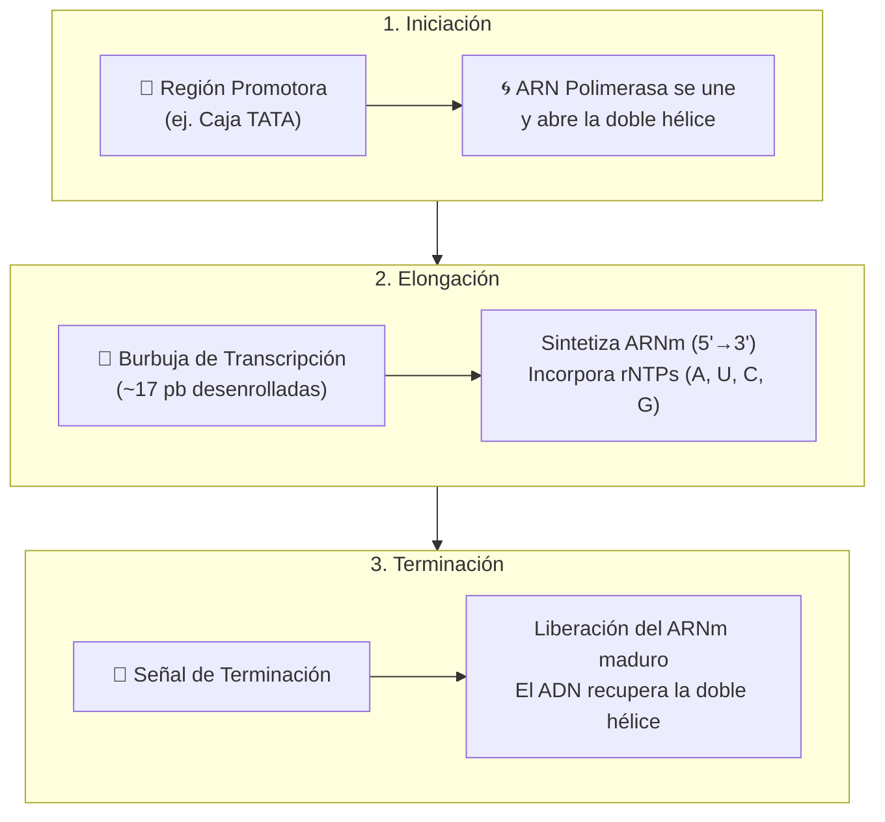

# Módulo de Transcripción del ADN

La transcripción es el proceso biológico fundamental mediante el cual la información genética contenida en una secuencia de ADN se transfiere a una molécula de **ARN mensajero (ARNm)** de cadena sencilla. Este proceso representa el primer paso del flujo de expresión génica.

---

## 1. Fundamento Biológico y Reglas Moleculares

A diferencia de la replicación (que duplica todo el genoma), la transcripción es un proceso altamente selectivo regulado por **promotores** y ejecutado por la **ARN Polimerasa**.



### Reglas Esenciales de la Transcripción
1. **Direccionalidad**: La ARN Polimerasa sintetiza el ARNm exclusivamente en dirección **$5' \to 3'$**, leyendo la cadena molde en sentido opuesto (**$3' \to 5'$**).
2. **Independencia de cebador**: A diferencia de las ADN polimerasas, la ARN polimerasa **no necesita un cebador preexistente** para comenzar la síntesis de novo.
3. **Regla del Uracilo ($U$)**: En el ARN, la base pirimidínica **Uracilo (U)** sustituye por completo a la **Timina (T)**. Por tanto, frente a una Adenina en la hebra molde de ADN, se incorpora siempre un Uracilo.

$$\text{ADN Molde: } 3'\text{-A-T-C-G-}5' \quad \longrightarrow \quad \text{ARNm: } 5'\text{-U-A-G-C-}3'$$

---

## 2. La Distinción Crítica: Cadena Molde vs. Cadena Codificante

Una de las fuentes de confusión más habituales en biología molecular es la polaridad de las dos hebras del ADN dúplex durante la transcripción:

```text
5'- A T G G C C A A C G T A -3'  (Cadena Codificante / Sentido)
    | | | | | | | | | | | |
3'- T A C C G G T T G C A T -5'  (Cadena Molde / Antisentido / Leída físicamente)
    ↓ ↓ ↓ ↓ ↓ ↓ ↓ ↓ ↓ ↓ ↓ ↓
5'- A U G G C C A A C G U A -3'  (ARNm Transcrito sintetizado)
```

| Tipo de Cadena | Orientación | Papel Biológico | Relación con el ARNm |
| :--- | :--- | :--- | :--- |
| **Cadena Molde** *(Template / Antisentido)* | **$3' \to 5'$** | Es la hebra sobre la que se desplaza físicamente la ARN Polimerasa. | **Complementaria y antiparalela** al ARNm. |
| **Cadena Codificante** *(Coding / Sentido)* | **$5' \to 3'$** | Hebra complementaria a la molde que queda excluida de la polimerización. | **Idéntica en secuencia al ARNm**, con la única salvedad de que la $T$ del ADN se sustituye por $U$. |

!!! warning "Trampa clásica de examen / defensa"
    **¿Por qué se llama "Cadena Codificante" a la que NO lee la ARN Polimerasa?**
    Se denomina "codificante" porque su secuencia de nucleótidos leída de $5' \to 3'$ es idéntica al mensaje genético final que llevará el ARNm hacia el ribosoma (cambiando $T$ por $U$). Por convenio internacional, las bases de datos genómicas (GenBank, NCBI, Ensembl) registran los genes en la orientación de la cadena codificante ($5' \to 3'$).

---

## 3. Implementación Algorítmica en Python

El módulo [`transcripcion.py`](#) implementa la transcripción garantizando la máxima precisión pedagógica:

### A. Mapeo de Complementariedad Estricto
Se define la relación directa entre el nucleótido de la hebra molde de ADN ($3' \to 5'$) y el ribonucleótido incorporado al ARNm ($5' \to 3'$):

```python
TRANSCRIPCION_MAP = {
    'A': 'U',  # Adenina en molde genera Uracilo en ARN
    'T': 'A',  # Timina en molde genera Adenina en ARN
    'C': 'G',  # Citosina genera Guanina
    'G': 'C'   # Guanina genera Citosina
}

def transcribir_cadena_molde(cadena_molde_3_5: str) -> str:
    """Transcribe una hebra molde 3'->5' a ARNm 5'->3'."""
    return "".join(TRANSCRIPCION_MAP.get(b.upper(), 'N') for b in cadena_molde_3_5)
```

### B. Modelado de la Burbuja de Transcripción
La ARN Polimerasa abre localmente una región de unos 15–18 pares de bases. El código modela dinámicamente este fenómeno generando un diagrama en texto plano que visualiza la separación transitoria de las hebras y la salida del ARNm naciente:

```python
# Ventana dinámica de la burbuja en el centro del transcrito
inicio_burbuja = max(0, mitad - 5)
fin_burbuja = min(len(cadena_codificante_5_3), mitad + 5)

burbuja_ascii = (
    f"5'- ... {codif_pre} ----\\    {codif_bur}    /---- {codif_post} ... -3' (Cadena Codificante)\n"
    f"                           \\                      /\n"
    f"             ARN Polimerasa [  ARNm: 5'- {arn_bur} ...  ]\n"
    f"                           /                      \\\n"
    f"3'- ... {molde_pre} ----/    {molde_bur}    \\---- {molde_post} ... -5' (Cadena Molde leída)"
)
```

---

## 4. Trazabilidad en Consola y Salida del Simulador

Durante la fase de transcripción, la interfaz de consola informa en tiempo real de cada suceso molecular:

```text
┌── [ ENZIMA / FACTOR: Factores de transcripción + ARN Polimerasa ] ─────────────────
│ Etapa: [1/3] Iniciación y Reconocimiento del Promotor
│ La ARN Polimerasa reconoce el promotor y selecciona la cadena molde (3'->5').
│
│ Representación molecular en tiempo real:
│   Cadena Codificante (sentido)    : 5'- ATGGCCAACGTACGTTCAGATGAAGCCTACTAA -3'
│   Cadena Molde (antisentido/leída): 3'- TACCGGTTGCATGCAAGTCTACTTCGGATGATT -5'
│   Sitio de unión ARN Polimerasa   : [=== PROMOTOR ===> Inicia síntesis hacia 3']
└───────────────────────────────────────────────────────────────────────────────────

┌── [ ENZIMA / FACTOR: ARN Polimerasa ] ─────────────────────────────────────────────
│ Etapa: [2/3] Elongación y Formación de la Burbuja
│ Desenrollado de bases y polimerización continua de rNTPs incorporando Uracilo.
│
│ Representación molecular en tiempo real:
│           Doble Hélice              Burbuja de Transcripción              Doble Hélice
│   5'- ... ATGGCCAAC ----\    GTACGTTCAG    /---- ATGAAGCCTACTAA ... -3' (Codificante)
│                          \                      /
│            ARN Polimerasa [  ARNm: 5'- GUACGUUCAG ...  ]
│                          /                      \
│   3'- ... TACCGGTTG ----/    CATGCAAGTC    \---- TACTTCGGATGATT ... -5' (Molde leída)
└───────────────────────────────────────────────────────────────────────────────────

┌── [ ENZIMA / FACTOR: ARN Polimerasa + Señal de Terminación ] ──────────────────────
│ Etapa: [3/3] Terminación y Liberación
│ El híbrido ADN-ARN se disocia y la doble hélice de ADN se reconstituye intacta.
│
│ Representación molecular en tiempo real:
│   ARNm Transcrito Sintetizado: 5'- AUGGCCAACGUACGUUCAGAUGAAGCCUACUAA -3'
│   Alineamiento con ADN molde : 3'- TACCGGTTGCATGCAAGTCTACTTCGGATGATT -5'
│   Fíjate: El ARNm es idéntico a la cadena codificante sustituyendo 'T' por 'U'.
└───────────────────────────────────────────────────────────────────────────────────
```

### Tabla de Fidelidad Nucleótido a Nucleótido

Para verificar que no existen mutaciones ni errores durante la transcripción, el programa genera una tabla de cotejo base por base:

| Posición | ADN Codificante ($5' \to 3'$) | ADN Molde ($3' \to 5'$) | ARNm Transcrito ($5' \to 3'$) | Apareamiento |
| :---: | :---: | :---: | :---: | :---: |
| 1 | `5'- A -3'` | `3'- T -5'` | `5'- A -3'` | $T_{\text{molde}} = A_{\text{ARN}}$ |
| 2 | `5'- T -3'` | `3'- A -5'` | `5'- U -3'` | $A_{\text{molde}} = U_{\text{ARN}}$ |
| 3 | `5'- G -3'` | `3'- C -5'` | `5'- G -3'` | $C_{\text{molde}} \equiv G_{\text{ARN}}$ |
| 4 | `5'- G -3'` | `3'- C -5'` | `5'- G -3'` | $C_{\text{molde}} \equiv G_{\text{ARN}}$ |
| ... | ... | ... | ... | ... |

---

## 5. El Transcrito Primario como Puente Hacia la Proteína

El producto final de esta etapa es una molécula monocatenaria de **ARNm maduro** ($5' \to 3'$). Esta secuencia contiene los tripletes de nucleótidos (**codones**) que serán descodificados por el ribosoma durante la fase siguiente: la **Traducción**.
